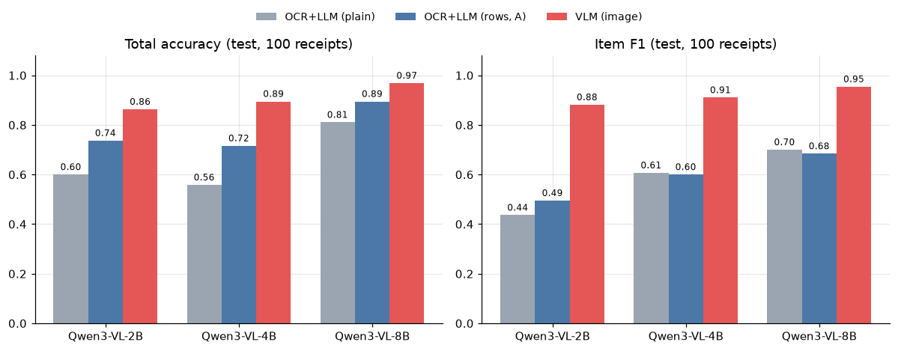
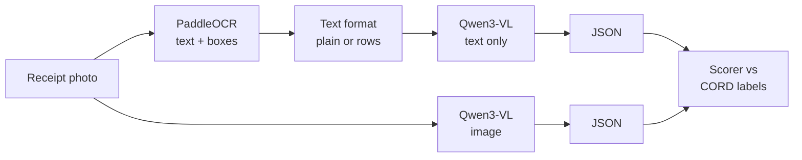
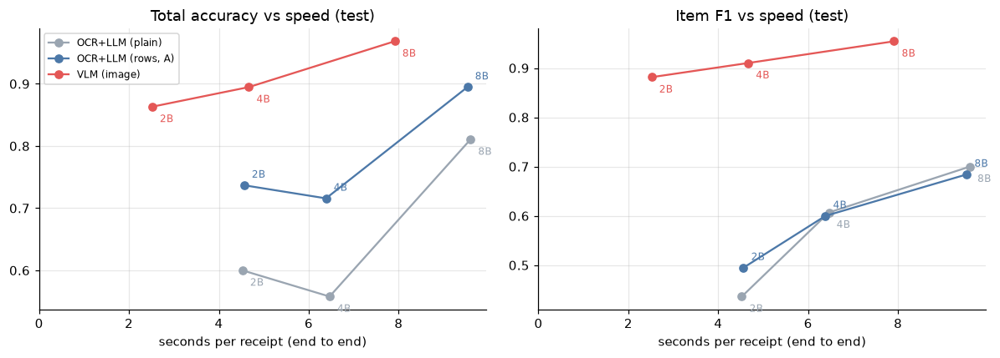
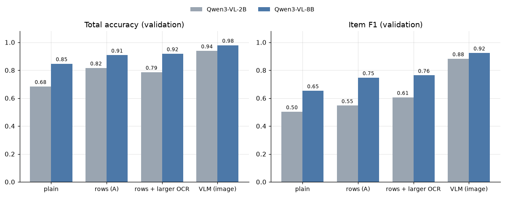

# Snap2JSON

**Snap a receipt, get structured JSON.** Which works better: OCR text fed to a language model, or a
vision-language model that reads the photo directly? This project measures both on the same receipts with the
**same model**, so only the input changes.



**Short answer (Qwen3-VL 2B / 4B / 8B, 100 CORD test receipts):** reading the image wins at every model size, on
every field, and is also **faster** end to end. Smarter OCR formatting closes about half of the gap on totals but
hardly any of it on line items.

> Status: the open-model pair (Qwen3-VL) is complete. The Gemini pair, cost per receipt and the web app are in
> progress ([TODO.md](TODO.md)). Every number here comes from a saved run; nothing is estimated unless marked.

---

## What it does

```json
{
  "merchant": null,
  "date": null,
  "items": [
    {"name": "REAL GANACHE", "qty": 1, "price": 16500},
    {"name": "EGG TART",     "qty": 1, "price": 13000},
    {"name": "PIZZA TOAST",  "qty": 1, "price": 16000}
  ],
  "subtotal": null,
  "tax": null,
  "total": 45500
}
```
*The schema, filled from CORD's labels for `val_0000` (a real receipt from the validation set).*

## The experiment



| | OCR + LLM | VLM |
|---|---|---|
| Input to the model | PaddleOCR text (no image) | the receipt photo |
| Model | Qwen3-VL-{2B, 4B, 8B}-Instruct | the same model |
| Prompt | identical, never tuned | identical, never tuned |

- **Data:** [CORD v2](https://huggingface.co/datasets/naver-clova-ix/cord-v2) (Indonesian receipts, CC-BY-4.0).
  Validation 100, **test 100** (main result), a fixed-seed train sample of 150 (extra test set), and 100 degraded
  copies of test (blur, rotate, darken, low-res).
- **Metrics:** exact match on total, subtotal and tax; item precision / recall / F1 (name fuzzy-matched, quantity and
  price exact); valid-JSON rate; seconds per receipt end to end. CORD has no merchant or date labels, so those are
  not scored.
- **Hardware:** models on an NVIDIA RTX 4000 Ada (20 GB), OCR on CPU (Intel Core Ultra 9 285).

## Results (test split)

| Model | Method | Total | Subtotal | Tax | Item F1 | Seconds / receipt |
|---|---|---|---|---|---|---|
| 2B | OCR+LLM, plain text | 0.600 | 0.769 | 0.634 | 0.436 | 4.53 |
| 2B | OCR+LLM, rows | 0.737 | **0.954** | 0.707 | 0.495 | 4.56 |
| 2B | **VLM (image)** | **0.863** | 0.923 | **0.805** | **0.881** | **2.52** |
| 4B | OCR+LLM, plain text | 0.558 | 0.631 | 0.537 | 0.607 | 6.46 |
| 4B | OCR+LLM, rows | 0.716 | 0.815 | 0.659 | 0.600 | 6.38 |
| 4B | **VLM (image)** | **0.895** | **0.954** | **0.805** | **0.910** | **4.67** |
| 8B | OCR+LLM, plain text | 0.811 | 0.831 | 0.634 | 0.700 | 9.60 |
| 8B | OCR+LLM, rows | 0.895 | 0.938 | 0.805 | 0.684 | 9.53 |
| 8B | **VLM (image)** | **0.968** | **0.985** | **0.878** | **0.954** | **7.91** |

Totals are scored on 95 receipts, subtotal on 65, tax on 41. Every run returned valid JSON on all test receipts. "Rows" groups OCR
boxes into printed lines (Method A, below). Full tables for all four splits: [results/REPORT.md](results/REPORT.md).



## Why does the text pipeline lose?

Each idea was tested, not assumed. Details and numbers are in [REPORT.md](results/REPORT.md), section 6.

1. **Not because OCR misreads the receipt.** On clean receipts OCR finds 97% of the labelled words with a 3%
   character error rate, and the right total is in the OCR text for 93% of test receipts.
2. **Layout is lost.** The plain OCR text puts every box on its own line, so a printed row like
   `DONAT GULA  1X  11,000` becomes three lines and prices drift away from their items. Grouping boxes back into
   rows (Method A) raises test total accuracy at every size (2B +14, 4B +16, 8B +8 points). Adding x-coordinates
   as numbers (Method B) made things worse.
3. **Small digits go missing.** Item counts are the weakest field for OCR (83% detected vs 98–99% for names and
   prices). A larger OCR detector halves those misses, but adds only 2–6 points of item F1 and makes OCR 4x slower.
4. **Number format.** Indonesian receipts write `60.000` for 60,000. Qwen3-VL-4B often copies that into JSON, where
   it means 60. That one habit explains why 4B scores below 2B on text totals.
5. **Bad photos hurt OCR most.** Blur and low resolution push OCR error to 33–42%; the VLM loses far less.



The scoring itself was checked: the name-match threshold was labelled by hand on validation, and a manual audit of
100 errors found only 3 caused by the scorer and 2 by the labels.

## Repository

```
src/receipt/        schema, number normalisation, disk cache, OCR (PaddleOCR + row layout), extractors (Qwen, Gemini)
eval/               run_eval.py (resumable runner), metrics.py, error audits, ocr_accuracy.py, analysis.ipynb
data/scripts/       download CORD, map labels to our schema, make degraded copies, run / time OCR
results/            REPORT.md, runs/ (every model output), tables/ (scores), charts/
cache/              OCR text and boxes (committed); model responses (not committed)
app/                FastAPI + Streamlit demo (in progress)
tests/              pytest, no GPU or API key needed
```

## Reproduce

Python 3.10+ (tested on 3.11). The models need a GPU with about 20 GB for 8B; OCR runs on CPU.

```bash
uv venv .venv && source .venv/bin/activate        # or: python -m venv .venv
uv pip install -e ".[dev,ocr,models,analysis]"
pytest                                            # 68 tests, no GPU or API key

# data (once): CORD images are not in git
python data/scripts/download_cord.py validation test
python data/scripts/download_cord.py train
python data/scripts/degrade.py

# models: both methods, all four splits (resumable; outputs in results/runs and results/tables)
bash run_all_qwen.sh --model Qwen/Qwen3-VL-2B-Instruct
bash run_all_qwen.sh                                          # 4B, the default
bash run_all_qwen.sh --model Qwen/Qwen3-VL-8B-Instruct
METHODS="ocr_llm_rows" bash run_all_qwen.sh --model Qwen/Qwen3-VL-8B-Instruct   # Method A (rows)

# charts
jupyter nbconvert --to notebook --execute --inplace eval/analysis.ipynb
```

OCR text and boxes are already committed in `cache/`, so the model runs do not need PaddleOCR. On Windows use
`.venv\Scripts\activate` and `run_all_qwen.bat`. For the Gemini methods, copy `.env.example` to `.env` and set
`GEMINI_API_KEY` and `GEMINI_MODEL`.

## Limitations

- One dataset (CORD, Indonesian receipts) and one open model family so far; the Gemini pair is not run yet.
- One run per setting with greedy decoding; no confidence intervals, and tax rests on as few as 41 receipts.
- The prompt was never tuned, on purpose; a tuned prompt might narrow the gap.
- OCR runs on CPU; GPU OCR would make the text pipeline faster.
- Cost per receipt is not computed yet.

## Roadmap

- [x] Qwen3-VL 2B / 4B / 8B, both methods, four splits
- [x] Layout, OCR, number-format and error analyses; charts
- [ ] Gemini Flash pair (free-tier limits, a few receipts per day)
- [ ] Cost per receipt (API prices from tokens; GPU-time estimate for Qwen)
- [ ] FastAPI + Streamlit demo, SQLite request logging, Docker, CI, Azure deploy (Gemini methods)

## Data and credits

Receipts and labels: CORD v2 by NAVER Clova (CC-BY-4.0). OCR: PaddleOCR (PP-OCRv5). Models: Qwen3-VL by the Qwen team.
